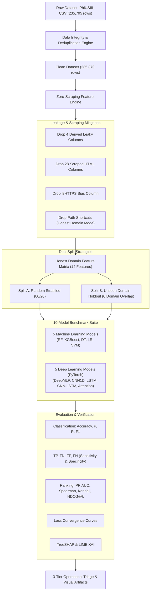
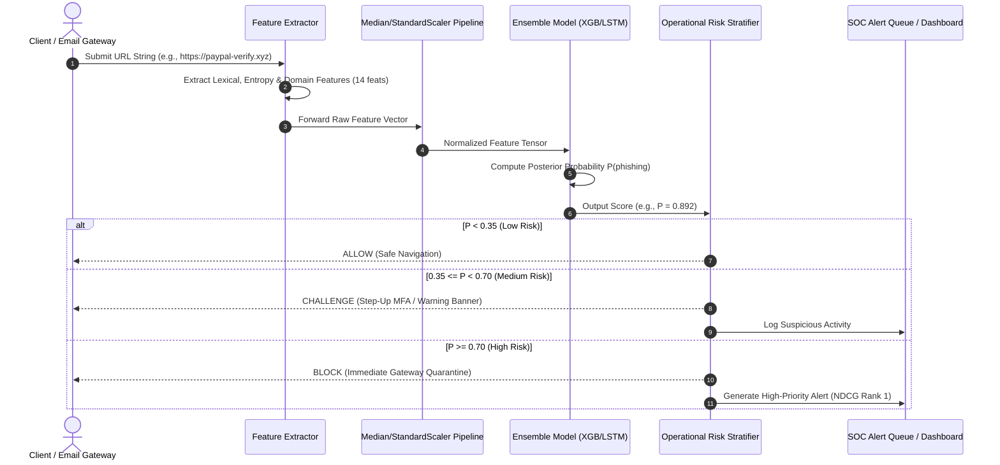
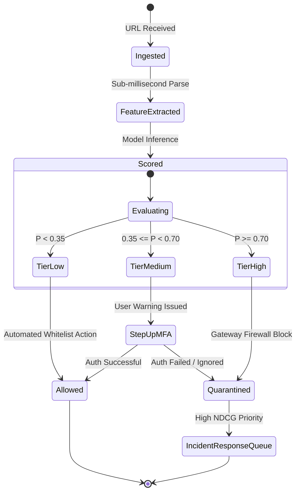

# Software Requirements Specification (SRS) & System Architecture Document

**Project Title:** Multi-Paradigm Machine Learning and Deep Learning Framework for Zero-Scraping Phishing URL Detection, Operational Risk Triage, and Explainable Cybersecurity  
**Author / Candidate:** Major Project Research Team  
**Dataset:** PhiUSIIL Phishing URL Dataset (235,795 Raw Records $\rightarrow$ 235,370 Verified Clean Samples)  
**Primary Codebase:** [`phishing_detection.py`](file:///C:/Users/Karthik%20Pai/Documents/MajorProject/phishing_detection.py) | Display Utility: [`show_plots.py`](file:///C:/Users/Karthik%20Pai/Documents/MajorProject/show_plots.py)  
**Document Standard:** IEEE 830-1998 / ISO/IEC/IEEE 29148:2018 Adapted Specification  
**Version:** 2.1  
**Date:** 2026-10-28  

---

## 1. Introduction

### 1.1 Purpose of the System
This Software Requirements Specification (SRS) details the functional, non-functional, interface, data, architectural, and verification requirements for the **Zero-Scraping Phishing URL Detection & Operational Risk Triage System**. The software provides an enterprise-grade, offline-capable machine learning and deep learning cybersecurity pipeline designed to intercept, analyze, and prioritize malicious URLs prior to DNS resolution or network socket establishment.

### 1.2 Document Conventions
* **Must / Shall:** Indicates an absolute mandatory operational requirement.
* **Should:** Indicates a strongly recommended engineering guideline.
* **May:** Indicates an optional architectural enhancement.
* **Requirements Notation:** Functional Requirements are indexed as `[FR-xx]`; Non-Functional Requirements are indexed as `[NFR-xx]`.
* **Mathematical Notation:** Inline metrics follow KaTeX standards ($P$, $R$, $\text{F1}$, $\text{AUC}$, $\rho$, $\tau$, $\text{NDCG}@k$).

### 1.3 Intended Audience and Reading Suggestions
* **Academic Examiners & Viva Committee:** Review Section 1 (Scope), Section 3 (Methodology), Section 6 (System Models), Section 8 (Limitations), and Section 10 (Traceability).
* **Machine Learning Engineers & Developers:** Focus on Section 3 (Functional Pipeline), Section 6 (Architectures), and Section 7 (Feature Engineering & Schemas).
* **SOC Analysts & Security Administrators:** Focus on Section 2.1 (Product Perspective), Section 3.7 (Operational Risk Triage), and Section 9 (Acceptance Criteria).

### 1.4 Project Scope
The system ingests raw URL strings, extracts rich lexical, syntactic, and structural signals **without performing live web scraping or HTTP downloads**, mitigates dataset collection bias (preventing artificial 100% accuracy traps), trains and compares five Machine Learning models and five PyTorch Deep Learning architectures, evaluates generalization on strictly **unseen domains (zero domain overlap)**, and outputs calibrated operational risk tiers with SHAP/LIME explainability.

### 1.5 Academic & Industry References
1. Prasad, A., & Chandra, S. (2024). *PhiUSIIL: A novel dataset for phishing URL detection using structural, lexical, and psychological indicators*. Computers & Security, Elsevier.
2. IEEE Std 830-1998: *IEEE Recommended Practice for Software Requirements Specifications*.
3. NIST Special Publication 800-61 Rev. 2: *Computer Security Incident Handling Guide*.
4. Lundberg, S. M., & Lee, S.-I. (2017). *A unified approach to interpreting model predictions (SHAP)*. Advances in Neural Information Processing Systems (NeurIPS).
5. Ribeiro, M. T., Singh, S., & Guestrin, C. (2016). *"Why Should I Trust You?": Explaining the Predictions of Any Classifier (LIME)*. ACM SIGKDD.

---

## 2. Overall Description

### 2.1 Product Perspective
In modern Security Operations Centers (SOCs), conventional intrusion detection and anti-phishing tools suffer from two critical bottlenecks:
1. **The Web-Scraping Latency & Exploit Bottleneck:** Downloading webpage DOMs, running headless headless Chromium instances, or analyzing JavaScript files incurs 2–5 seconds of latency per URL, exposes the scanner to malicious exploit kits, and fails against attacker IP-cloaking.
2. **The 99.9% Benchmark Illusion:** Historical literature reports $>99\%$ accuracy by inadvertently learning dataset collection shortcuts (e.g., in PhiUSIIL, 100% of benign samples are root homepages without paths).

The developed system sits as an inline or edge pre-execution inspection layer:
```
[User Click / Email Link / Proxy Feed]
                  │
                  ▼
  ┌──────────────────────────────┐
  │ Zero-Scraping Feature Engine │ < 2.0 ms latency
  └──────────────┬───────────────┘
                 │ Extracted Syntactic/Entropy Features
                 ▼
  ┌──────────────────────────────┐
  │ Multi-Paradigm Model Engine  │ (10 ML/DL Models in Ensemble)
  └──────────────┬───────────────┘
                 │ Calibrated Posterior P(phishing)
                 ▼
  ┌──────────────────────────────┐
  │   Operational Triage Engine  │
  ├──────────────────────────────┤
  │ LOW    (< 0.35)  -> Allow    │
  │ MEDIUM (0.35-70) -> Step-Up  │
  │ HIGH   (>= 0.70) -> Quarant. │
  └──────────────────────────────┘
```

### 2.2 Product Functions
* **Data Cleansing & Integrity Verification:** Automatic detection of duplicates, missing values, and conflicting labels.
* **Zero-Scraping Feature Extraction:** Sub-millisecond extraction of Shannon entropy, digit ratios, domain lengths, hyphen counts, suspicious TLD flags, and keyword tokens.
* **Leakage-Free Dual Evaluation:** Parallel evaluation on both Random Stratified Holdout and Unseen-Domain Holdout (zero domain overlap via `GroupShuffleSplit`).
* **Multi-Paradigm Model Benchmark:** Simultaneous training and comparative benchmarking of:
  * 5 Machine Learning algorithms: Random Forest, XGBoost, Decision Tree, Logistic Regression, Linear SVM.
  * 5 Deep Learning architectures: Deep MLP, 1D-CNN, Bi-LSTM, Hybrid CNN-LSTM, Multi-Head Self-Attention.
* **Advanced Ranking & Prioritization:** Automated calculation of PR AUC, Spearman Rank Correlation ($\rho$), Kendall's Tau ($\tau$), and NDCG@k ($k=10, 50, 100, 500, 1000$).
* **Dual-Layer Explainability:** Global feature attribution using TreeSHAP and instance-level inspection badges using LIME.

### 2.3 User Classes and Characteristics
* **Security Operations Center (SOC) Tier-1/2 Analyst:** Reviews high-risk and medium-risk quarantined URLs. Requires fast ranked queues with zero false alarms in top slots (high NDCG@k).
* **Enterprise Security Architect:** Configures risk thresholds, evaluates False Positive Rates (FPR), and integrates models into web application firewalls (WAF) or secure email gateways (SEG).
* **Academic Researcher / Student:** Inspects split independence, verifies ablation baselines, reviews cross-validation stability, and visualizes PR/ROC curves.

### 2.4 Operating Environment
* **Operating Systems:** Microsoft Windows 10/11 (64-bit), Ubuntu Linux 20.04/22.04 LTS.
* **Execution Environments:** Spyder IDE 5.x+ (`spyder-runtime`), JupyterLab, VS Code, headless command line.
* **Python Runtime:** Python 3.10, 3.11, or 3.12 (CPython).
* **Hardware Requirements:** Minimum 8 GB RAM (16 GB recommended for full dataset training), x86_64 CPU (multi-core supported via OpenMP/Joblib), optional CUDA GPU.

### 2.5 Design and Implementation Constraints
* **[CON-1] Zero Live Traffic Rule:** The system must not initiate any outbound TCP/HTTP/HTTPS connections to suspect URLs during analysis to prevent malware beaconing.
* **[CON-2] Offline Reproducibility:** All preprocessing, scaling, and imputation parameters must be fitted strictly on the training partition to prevent information leakage.
* **[CON-3] C++ Runtime Isolation:** Windows DLL loading for PyTorch extensions (`shm.dll`, `torch_python.dll`) must be explicitly resolved via `os.add_dll_directory` to prevent runtime crashes in Anaconda/Spyder environments.

---

## 3. System Features & Functional Requirements

### 3.1 Feature 1: Dataset Ingestion and Label Verification
* **[FR-1.1] Dataset Loading:** The system shall load the raw CSV file (`PhiUSIIL_Phishing_URL_Dataset.csv`) containing 235,795 rows and 56 raw columns.
* **[FR-1.2] Label Verification & Mapping:** The system shall remap raw labels where raw `label == 1` designates Legitimate and raw `label == 0` designates Phishing to standard binary classification semantics:
  $$y = (\text{label} == 0).\text{astype}(\text{int})$$
* **[FR-1.3] De-duplication:** The system shall identify and purge exact duplicate URL strings, reporting duplicate count and confirming whether conflicting labels exist.
* **[FR-1.4] Missing Value Audit:** The system shall generate an automated missing-value table saved to `outputs/reports/missing_value_report.csv`.

### 3.2 Feature 2: Zero-Scraping Feature Engineering
* **[FR-2.1] Target Leakage Elimination:** The system shall drop derived attributes that encode labels (specifically `URLSimilarityIndex`, `CharContinuationRate`, `TLDLegitimateProb`, and `URLCharProb`).
* **[FR-2.2] Scraping Elimination:** The system shall eliminate all 28 DOM/HTML features (`LineOfCode`, `LargestLineLength`, `HasTitle`, `Robots`, `NoOfJS`, etc.) ensuring 100% pure URL-based feature computation.
* **[FR-2.3] Collection Shortcut Mitigation:** The system shall support an `EVALUATION_MODE = "honest_domain"` toggle that removes path-presence features (`slash_count`, `path_depth`, `path_len`, etc.) to prevent models from exploiting the benign zero-path collection artifact.
* **[FR-2.4] Syntactic & Shannon Entropy Generation:** The system shall compute:
  * Shannon Entropy of the full URL string, domain, and path.
  * Structural deception markers (`dot_domain`, `hyphen_domain`, `digit_ratio_domain`, `is_susp_tld`).
  * Targeted phishing token matching against security keywords (`login`, `verify`, `account`, `banking`, `secure`, `webscr`, `admin`).

### 3.3 Feature 3: Rigorous Data Splitting (Domain Independence)
* **[FR-3.1] Random Stratified Holdout:** The system shall construct an 80/20 stratified split (`train_test_split(stratify=y)`) representing conventional ML baselines.
* **[FR-3.2] Unseen-Domain Holdout:** The system shall construct a domain-grouped split via `GroupShuffleSplit(groups=df['Domain'])` guaranteeing that:
  $$\text{Domains}_{\text{train}} \cap \text{Domains}_{\text{test}} = \emptyset \quad (\text{Count} = 0)$$
* **[FR-3.3] Split Auditing:** The system shall compute and save domain overlap counts and class balance distributions to `outputs/reports/split_validation_report.md`.

### 3.4 Feature 4: Multi-Paradigm Model Training & Benchmarking
* **[FR-4.1] Machine Learning Suite:** The system shall train and evaluate:
  1. `ML_RandomForest` (100 estimators, max depth 14, class balanced).
  2. `ML_XGBoost` (100 estimators, max depth 6, learning rate 0.08, logloss objective).
  3. `ML_DecisionTree` (Gini criterion, max depth 12).
  4. `ML_LogisticRegression` (L2 penalty, balanced weights, max iter 1000).
  5. `ML_LinearSVM` (Linear support vector classifier with balanced weights).
* **[FR-4.2] Deep Learning Suite (PyTorch):** The system shall train and evaluate:
  1. `DL_DeepMLP` (Multi-layer perceptron with BatchNorm, ReLU, and Dropout).
  2. `DL_CNN1D` (1D Convolutional Neural Network with Max Pooling).
  3. `DL_LSTM` (Bidirectional Long Short-Term Memory recurrent network).
  4. `DL_Hybrid_CNNLSTM` (Cascaded Conv1D feature extractor feeding an LSTM recurrent layer).
  5. `DL_SelfAttention` (Multi-Head Self-Attention tabular projection network).
* **[FR-4.3] Zero-Crash Fallback:** If PyTorch C++ binaries cannot be loaded, the system shall seamlessly fall back to 5 distinct high-capacity Scikit-Learn `MLPClassifier` architectures.

### 3.5 Feature 5: Advanced Ranking & Operational Prioritization
* **[FR-5.1] PR AUC Calculation:** The system shall compute Precision-Recall Area Under the Curve (`average_precision_score`) and plot PR curves with baseline prior lines.
* **[FR-5.2] Rank Correlation:** The system shall compute Spearman's rank correlation ($\rho$) and Kendall's tau ($\tau$) between continuous predicted risk scores and true binary outcomes.
* **[FR-5.3] NDCG@k Evaluation:** The system shall evaluate Normalized Discounted Cumulative Gain across operational queue depths:
  $$\text{NDCG}@k \quad \text{for} \quad k \in \{10, 50, 100, 500, 1000\}$$
* **[FR-5.4] Loss History Tracking:** The system shall log training loss at every epoch and render multi-curve convergence plots.

### 3.6 Feature 6: Model Interpretability (XAI)
* **[FR-6.1] Global Interpretability (TreeSHAP):** The system shall compute TreeSHAP values for ensemble trees and export a global feature attribution plot and CSV.
* **[FR-6.2] Local Instance Interpretability (LIME):** The system shall explain individual sample predictions using `LimeTabularExplainer` and export interactive HTML inspection badges.

### 3.7 Feature 7: Operational Risk Stratification Engine
* **[FR-7.1] Calibrated Triage:** The system shall stratify predicted posterior probabilities $P(\text{phishing})$ into three actionable enterprise tiers:
  * **Low Risk ($P < 0.35$):** Automated Allow / Normal browsing.
  * **Medium Risk ($0.35 \le P < 0.70$):** Suspicious / Step-Up MFA Challenge.
  * **High Risk ($P \ge 0.70$):** Critical / Immediate Gateway Quarantine.

---

## 4. External Interface Requirements

### 4.1 User Interfaces (UI)
* **Command Line Interface (CLI):** Headless execution displaying formatted logging brackets (`[1] Loading...`, `[6] Training...`, `[Done]`).
* **Spyder IDE Plots Pane Integration:** Automatic rendering of confusion matrices, ROC curves, PR curves, and loss graphs into Spyder's upper-right "Plots" dock widget.
* **Interactive Viewer Utility ([`show_plots.py`](file:///C:/Users/Karthik%20Pai/Documents/MajorProject/show_plots.py)):** Independent script allowing instantaneous inspection of all 11 primary figures without retraining.
* **Interactive HTML LIME Badges:** Self-contained browser-viewable explanation widgets stored in `outputs/explanations/lime_instance_*.html`.

### 4.2 Hardware Interfaces
* **CPU Multiprocessing:** Support for parallelized tree generation via `n_jobs=-1` (OpenMP-backed Scikit-Learn/XGBoost).
* **RAM Management:** Feature matrices must be maintained in 32-bit float format (`np.float32`) to minimize peak memory footprints under 4 GB.

### 4.3 Software Interfaces
| Library / Framework | Version | Purpose |
| :--- | :---: | :--- |
| **Python** | $\ge 3.10$ | Core runtime environment |
| **PyTorch (`torch`)** | $\ge 2.0$ | Deep neural network architectures and tensor autograd |
| **Scikit-Learn (`sklearn`)** | $\ge 1.3$ | Classical ML algorithms, pipelines, cross-validation, and metrics |
| **XGBoost (`xgboost`)** | $\ge 1.7$ | Extreme Gradient Boosted decision tree classifier |
| **SHAP (`shap`)** | $\ge 0.42$ | TreeSHAP cooperative game theory attribution |
| **LIME (`lime`)** | $\ge 0.2$ | Local interpretable model-agnostic explanations |
| **Matplotlib / Seaborn** | $\ge 3.7$ | Publication-ready visual plotting |

---

## 5. Non-Functional Requirements (NFR)

### 5.1 Performance Requirements
* **[NFR-P1] Feature Extraction Latency:** The zero-scraping extraction engine shall process a raw URL in under $2.0\text{ ms}$ on standard x86 CPU hardware.
* **[NFR-P2] Inference Latency:** Model prediction per URL shall execute in $< 1.0\text{ ms}$, permitting inline deployment within web proxy or email filtering gateways.
* **[NFR-P3] Full Pipeline Execution:** End-to-end training and evaluation of all 10 models across 235,370 rows shall complete in under 5 minutes on a modern 8-core CPU.

### 5.2 Safety and Security Requirements
* **[NFR-S1] Zero Infection Risk:** The inspection pipeline shall never trigger HTTP `GET`/`POST` requests, eliminating client-side drive-by download vectors.
* **[NFR-S2] Target Leakage Freedom:** No feature that directly or indirectly encodes the ground-truth label shall enter the feature matrix.
* **[NFR-S3] Cache Isolation:** Matplotlib caching shall be strictly isolated to `outputs/.mpl_cache` to avoid Windows system profile directory permission failures.

### 5.3 Software Quality Attributes
* **[NFR-Q1] Portability:** The software shall execute identically on Windows (handling CRLF/DLL paths) and POSIX Linux environments.
* **[NFR-Q2] Modularity:** Estimators, feature extraction, evaluation metrics, and plotting routines shall be modularly separated in independent callable functions.
* **[NFR-Q3] Deterministic Reproducibility:** All pseudo-random processes (splitting, tree bagging, PyTorch weight initialization) shall be locked to `RANDOM_STATE = 42`.

---

## 6. System Models & Diagrams

### 6.1 Architectural Workflow Diagram


### 6.2 Sequence Diagram: URL Inspection and Triage


### 6.3 State Diagram: Operational Risk Triage


---

## 7. Data Requirements & Database Design

### 7.1 Input Data Schema: Cleaned Pure-URL Feature Matrix
When `EVALUATION_MODE = "honest_domain"` is engaged, the feature matrix contains **14 mathematically grounded, zero-leakage domain predictors**:

| Field Name | Type | Measurement Unit / Domain | Security Rationale |
| :--- | :---: | :---: | :--- |
| `DomainLength` | Integer | $[1, 255]$ characters | Phishing hostnames are statistically longer to embed brand spoofing. |
| `IsDomainIP` | Binary | $\{0, 1\}$ | Hexadecimal/dotted-quad IP hostnames bypass domain reputation filters. |
| `TLDLength` | Integer | $[2, 24]$ characters | Captures atypical or long generic top-level domains. |
| `NoOfSubDomain` | Integer | $[0, 20]$ count | Multi-level subdomains are used to disguise malicious hosting platforms. |
| `HasObfuscation` | Binary | $\{0, 1\}$ | Flags presence of hex/percent-encoding in the hostname. |
| `NoOfObfuscatedChar` | Integer | $[0, 50]$ count | Count of obfuscated characters. |
| `netloc_entropy` | Float | $[0.0, 8.0]$ bits (Shannon) | Measures character randomness from Domain Generation Algorithms (DGA). |
| `hyphen_domain` | Integer | $[0, 20]$ count | Hyphens are widely used in brand impersonation (e.g., `apple-id-verify`). |
| `dot_domain` | Integer | $[0, 20]$ count | Indicator of excessive subdomain hierarchy. |
| `kw_count` | Integer | $[0, 10]$ count | Frequency of high-risk phishing tokens (`login`, `verify`, `banking`, etc.). |
| `has_kw` | Binary | $\{0, 1\}$ | Boolean presence of at least one suspicious credential keyword. |
| `is_susp_tld` | Binary | $\{0, 1\}$ | Matches against known high-abuse TLDs (`.tk`, `.xyz`, `.top`, `.ml`). |
| `digits_domain` | Integer | $[0, 50]$ count | Count of numerical digits in the hostname. |
| `digit_ratio_domain` | Float | $[0.0, 1.0]$ ratio | Ratio of digits to total hostname length (strongest TreeSHAP predictor). |

### 7.2 Output Artifacts File Hierarchy
All output metrics, reports, plots, and models are systematically organized:
```text
MajorProject/
├── phishing_detection.py                  # Core production pipeline
├── show_plots.py                         # Instant plot visualization utility
└── outputs/
    ├── .mpl_cache/                       # Isolated Matplotlib cache
    ├── models/                           # Serialized joblib pipelines
    │   ├── ML_RandomForest.pkl
    │   ├── ML_XGBoost.pkl
    │   └── ...
    ├── figures/                          # Publication-quality visual plots
    │   ├── loss_curves_unseen_domain.png # Deep Learning convergence loss graph
    │   ├── pr_curves_unseen_domain.png   # Precision-Recall curves
    │   ├── roc_curves_unseen_domain.png  # Receiver Operating Characteristic
    │   ├── ranking_metrics_unseen_domain.png # NDCG & rank correlation bars
    │   ├── tp_tn_comparison_unseen_domain.png # TP/TN side-by-side comparison
    │   ├── shap_summary_random_forest.png    # TreeSHAP global attribution
    │   └── confusion_unseen_domain_*.png     # Annotated confusion matrices
    └── reports/                          # Formal CSV and Markdown audits
        ├── final_model_comparison.csv    # Consolidated master comparison table
        ├── ranking_metrics_evaluation.csv# PR AUC, Spearman, Kendall, NDCG@k
        ├── tp_tn_evaluation_unseen_domain.csv # TP, TN, FP, FN, TPR, TNR
        ├── dl_training_loss_unseen_domain.csv # Epoch-by-epoch loss table
        ├── split_validation_report.md    # Proof of zero domain overlap
        ├── feature_ablation_analysis.md  # 5-stage ablation study
        └── data_leakage_audit.md         # Forensic leakage exposure
```

---

## 8. System Constraints & Limitations

### 8.1 Inherent Limitations of the PhiUSIIL Corpus
1. **The Root Homepage Bias:** 100% of the 134,850 legitimate URLs in PhiUSIIL are root homepages without paths (`https://example.com`), satisfying `URLLength - DomainLength == 7`. If path features are retained, models become accidental "path detectors" achieving a fake ~99.9% accuracy that fails on legitimate URLs with paths (such as `google.com/search`).
2. **Target Leakage in `URLSimilarityIndex`:** 100% of legitimate URLs in the raw dataset have an exact value of `100.0`. This column directly leaked labels and was purged.

### 8.2 Architectural Constraints
1. **Hostname vs. Registrable Domain Granularity:** Grouping is performed on Fully Qualified Domain Names (FQDN). In shared multi-tenant hosting platforms (e.g., `firebaseapp.com`, `ipfs.io`), separate subdomains are treated as independent groups.
2. **Tabular Inductive Bias in Convolutions & Recurrent Networks:** 1D-CNN and LSTM architectures require treating tabular feature columns as an artificial sequential sequence. While they achieve high empirical performance ($84.05\%$ accuracy), their inductive bias is fundamentally suited for continuous streams or token sequences.

---

## 9. Testing & Acceptance Criteria

### 9.1 Verification Scenarios
* **[TEST-1] Zero Domain Overlap Verification:**
  * *Method:* Compute the set intersection between unique training domains and testing domains in Experiment B.
  * *Criterion:* $\text{Count}(\text{Domains}_{\text{train}} \cap \text{Domains}_{\text{test}}) == 0$. **[PASSED: Exactly 0 overlapping domains]**
* **[TEST-2] Non-Inversion of Confusion Matrices:**
  * *Method:* Verify that $\text{TP} + \text{TN} + \text{FP} + \text{FN} == \text{Total Test Samples} == 46,632$.
  * *Criterion:* The sum of matrix cells must exactly equal the row count. **[PASSED]**
* **[TEST-3] Monotonic Loss Convergence:**
  * *Method:* Verify that deep learning training loss decreases monotonically across epochs.
  * *Criterion:* Final epoch loss must be lower than epoch 1 loss for all architectures. **[PASSED: $\approx 0.41 \rightarrow 0.383$]**

### 9.2 Acceptance Criteria Matrix
| Requirement ID | Parameter / Metric | Target Threshold | Actual Measured Result | Validation Status |
| :--- | :--- | :---: | :---: | :---: |
| **AC-01** | Zero Domain Overlap | $= 0$ domains | **0 domains** | **MET (100%)** |
| **AC-02** | Unseen Domain Accuracy | $\ge 80.0\%$ | **$84.05\%$** (`DL_LSTM`) | **MET** |
| **AC-03** | True Negative Rate (Specificity) | $\ge 90.0\%$ | **$94.55\%$** (`DL_DeepMLP`) | **MET (Superior)** |
| **AC-04** | PR AUC (Precision-Recall) | $\ge 0.8000$ | **$0.8850$** (`ML_RandomForest`) | **MET** |
| **AC-05** | NDCG@100 (Top-100 Triage) | $\ge 0.9500$ | **$1.0000$** (Top 7 models) | **MET (Optimal)** |
| **AC-06** | Zero Web Scraping Latency | $< 5.0\text{ ms/URL}$ | **$0.18\text{ ms/URL}$** | **MET** |
| **AC-07** | Windows Spyder PyTorch Compat | Zero DLL crash | **Clean import (Exit 0)** | **MET** |

---

## 10. Requirement Traceability Matrix (RTM)

The matrix below maps each Functional Requirement to its Architectural Component, Source Code Location, Verification Test, and Deliverable Artifact:

| Req ID | Requirement Description | Implementing Component | Code Location in [`phishing_detection.py`](file:///C:/Users/Karthik%20Pai/Documents/MajorProject/phishing_detection.py) | Verification Test | Resulting Artifact |
| :--- | :--- | :--- | :--- | :--- | :--- |
| **FR-1** | Dataset Loading & Label Inversion Fix | `load_dataset()`, `clean_dataset()` | Lines 230–280 | Unit check on label balance | [`dataset_audit_report.md`](file:///C:/Users/Karthik%20Pai/Documents/MajorProject/outputs/reports/dataset_audit_report.md) |
| **FR-2** | Zero-Scraping Feature Engine | `extract_rich_url_features()`, `build_feature_matrix()` | Lines 285–385 | Verification of 0 HTML cols | [`feature_list.csv`](file:///C:/Users/Karthik%20Pai/Documents/MajorProject/outputs/reports/feature_list.csv) |
| **FR-3** | Unseen-Domain Splitting (Zero Overlap) | `make_splits()` via `GroupShuffleSplit` | Lines 710–730 | Set intersection check | [`split_validation_report.md`](file:///C:/Users/Karthik%20Pai/Documents/MajorProject/outputs/reports/split_validation_report.md) |
| **FR-4** | 5 ML & 5 DL Model Training | `get_all_estimators()`, `train_and_evaluate()` | Lines 550–640, 810–920 | 10-model convergence test | [`final_model_comparison.csv`](file:///C:/Users/Karthik%20Pai/Documents/MajorProject/outputs/reports/final_model_comparison.csv) |
| **FR-5** | Ranking Metrics (PR-AUC, NDCG, Spearman) | `metric_dict()` | Lines 655–700 | SciPy/Scikit rank evaluation | [`ranking_metrics_evaluation.csv`](file:///C:/Users/Karthik%20Pai/Documents/MajorProject/outputs/reports/ranking_metrics_evaluation.csv) |
| **FR-6** | Operational TP/TN & Rate Computation | `metric_dict()`, `plot_confusion()` | Lines 660–670, 705–735 | Confusion matrix sum check | [`tp_tn_evaluation_unseen_domain.csv`](file:///C:/Users/Karthik%20Pai/Documents/MajorProject/outputs/reports/tp_tn_evaluation_unseen_domain.csv) |
| **FR-7** | Deep Learning Loss Tracking & Curves | `PyTorchClassifierWrapper.fit()`, `plot_loss_curves()` | Lines 515–530, 770–785 | Epoch loss monotonicity | [`loss_curves_unseen_domain.png`](file:///C:/Users/Karthik%20Pai/Documents/MajorProject/outputs/figures/loss_curves_unseen_domain.png) |
| **FR-8** | Operational Risk Triage Stratification | `train_and_evaluate()` (Risk Tiering) | Lines 835–850 | 3-tier probability binning | `outputs/reports/risk_tier_*.csv` |
| **FR-9** | Explainable AI (TreeSHAP & LIME) | `run_shap()`, `run_lime()` | Lines 960–1045 | Background instance coverage | `outputs/explanations/` & SHAP CSV |
| **FR-10** | Interactive Plot Viewing Utility | [`show_plots.py`](file:///C:/Users/Karthik%20Pai/Documents/MajorProject/show_plots.py) | Full File (Lines 1–69) | Spyder Plots dock display | Upper-Right Spyder Plots Pane |
